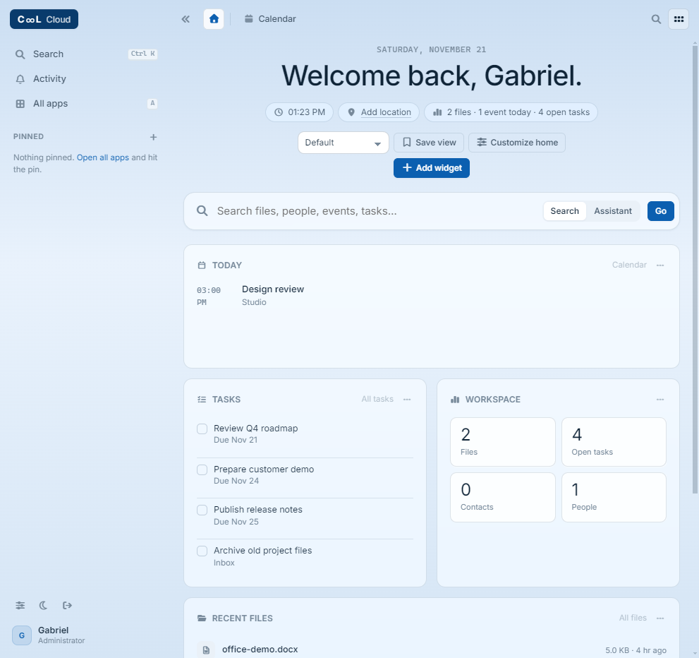
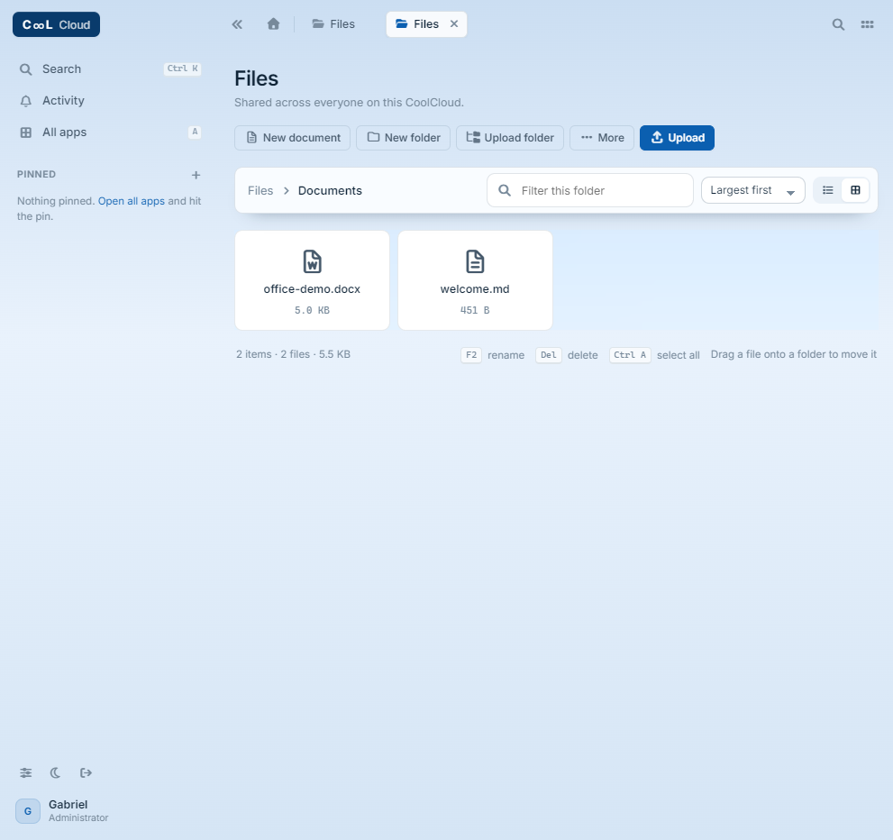
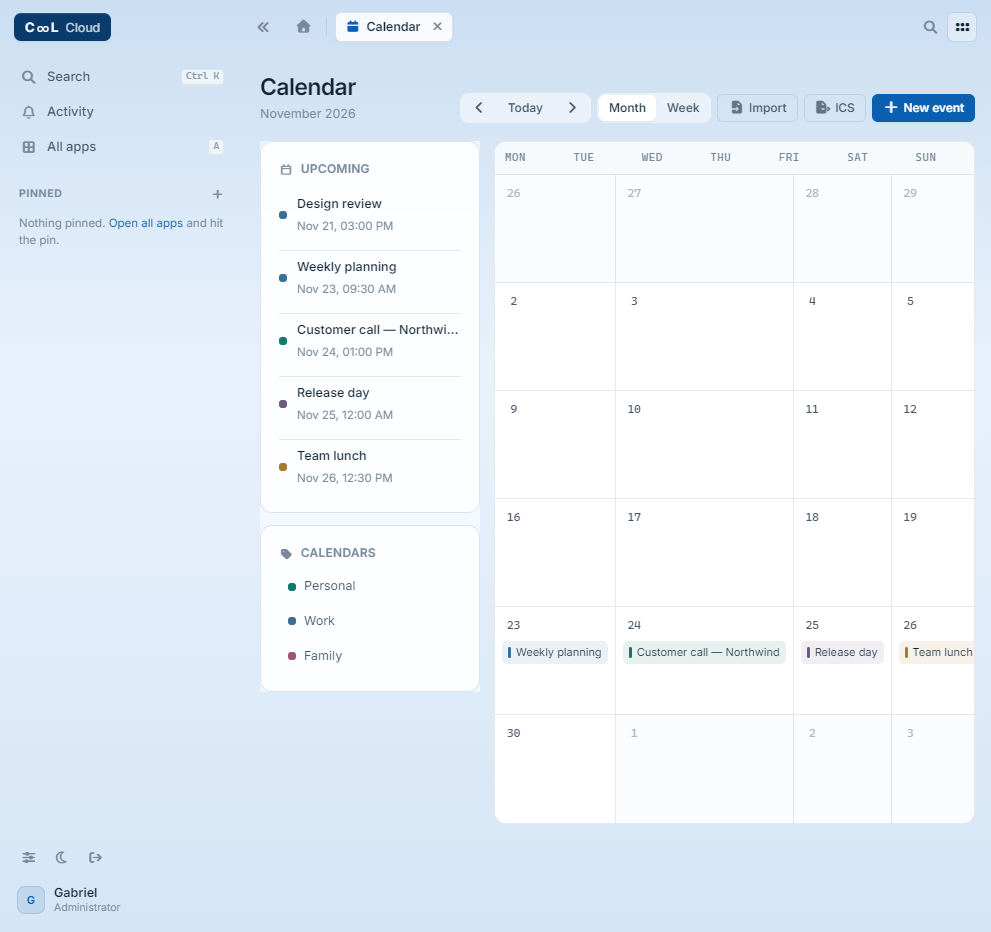

# CoolCloud Community


**Your own cloud. One install, every tool your team needs.**

CoolCloud is a self-hosted collaboration suite: files, calendar, mail, contacts, an editor, tasks and the apps your team actually works in, all on your own hardware under your own accounts. No seat licensing, no outsourced storage, no surprise.

**[CoolCloud website](https://openhcat.github.io/cc-appregistry/)** — the product site, editions and deployment help.

**[Get Enterprise for more apps →](mailto:coolcloud.getenterprise@hatcat.me)** — Helpdesk, Inventory, Uptime & Status, the full CRM and Finance, SSO and encryption at rest.

```bash
git clone https://github.com/openhcat/CoolCloud-Community.git
cd CoolCloud-Community
chmod +x coolcloud            # Linux; on Windows use coolcloud.cmd
node bin/coolcloud.js --install

# after the wizard, start the instance you created
cd ~/coolcloud && ./start.sh  # Windows: start.cmd
```

Then open `http://localhost:8080`.

## Two editions

| | **Community** (this repository) | **Enterprise** (private) |
| --- | --- | --- |
| License | MIT | Commercial |
| Files, Calendar, Mail, Contacts, Editor, Tasks | ✓ | ✓ |
| Connect, Media, Assistant | ✓ | ✓ |
| CRM, Finance, Projects, Studio | ✓ | ✓ |
| App registry, App Store, publishing | ✓ | ✓ |
| Accent colour personalisation | ✓ | ✓ |
| **Rename the product and replace the wordmark/logo** | — | ✓ |
| **CRM pipeline and forecasting, Finance expenses/recurring/export** | — | ✓ |
| **SSO (OpenID Connect) sign-in** | — | ✓ |
| **Encryption at rest for secrets and app data** | — | ✓ |
| **CC Defender: login lockouts, IP allow/deny lists, country blocks, CLI/API guard** | — | ✓ |
| **IP allowlists, password policy, session caps, audit export** | — | ✓ |
| Priority support and deployment review | — | ✓ |

Community is complete for a small team and permanently free. **CoolCloud Enterprise** adds the branded edition, SSO, encryption at rest, hardening controls and the fuller CRM/Finance apps. More at the [CoolCloud website](https://openhcat.github.io/cc-appregistry/).

## Screenshots



| Files | Calendar |
| --- | --- |
|  |  |

---

## What's inside

| App | What it does |
| --- | --- |
| **Files** | Folder tree, uploads, downloads, versions of your own text files, previews, streaming playback |
| **Calendar** | Multiple calendars, all-day events, month/week/day views |
| **Mail** | Connect any SMTP server to send, and any IMAP server to read your inbox |
| **Contacts** | People, organisations, notes, quick actions |
| **Editor** | Built-in text/Markdown editing, and office documents edited in place by a Collabora server CoolCloud hosts for you |
| **Tasks** | The base app: lists, due dates, priorities, done state |
| **Search** | One box over your files, apps, people, events and tasks — plus server config for admins |
| **Admin** | Users, quotas, storage, server health, error log, app toggles, app store, and appearance (accent colour) |

### Essentials Pack (optional at install)

| App | What it does |
| --- | --- |
| **Connect** | A real workspace: channels, direct messages, invites with Activity alerts, peer-to-peer voice/video and a private test call |
| **Media** | Photo and video library with a real player, straight from your Files |
| **Assistant** *(BETA)* | An assistant that can see your CoolCloud. Bring your own key |
| **CRM** | A focused contacts book: people, companies, email, phone and notes |
| **Finance** | Simple invoicing: number, client, amount, dates and status |
| **Projects** | Boards, tasks, owners and progress for the work you ship |
| **Studio** | Share links and file review: publish, expire and revoke links, read and reply to comments |

The Essentials Pack apps are real packages served by the app registry — installing the pack is the same code path as installing anything else from the store.

The Community CRM and Finance are deliberately small: a contacts book and an invoice list. **CoolCloud Enterprise** replaces them with fuller apps — a deal pipeline with forecasting, expenses, recurring invoices and CSV export — plus SSO, encryption at rest and the security policy controls described below.

---

## Install

**Requirements:** Linux or Windows with Node.js 24+ (and Python 3.8+ only if you want the standalone remote CLI).

```bash
git clone https://github.com/openhcat/CoolCloud-Community.git
cd CoolCloud-Community
node bin/coolcloud.js --install
```

`--install` walks you through:

1. **Where to install** — a directory that will hold config, data and apps
2. **Storage** — a cap in GB, or `Unlimited` (uses whatever the machine gives it)
3. **Accounts** — how many users the server may hold, or Unlimited
4. **The first admin account**
5. **Essentials Pack** — Connect, Media, Assistant, CRM, Finance, Projects and Studio, if you want them
6. **The optional CLI** — a launcher for the standalone remote CLI, if you want one

It pulls the app catalogue from the [Official App Registry](https://github.com/openhcat/cc-appregistry), installs the pack you chose, writes the config, creates the admin and prints:

```
  Welcome to CoolCloud

  [x] Delete unnecessary setup files (RECOMMENDED)
  [ ] Start CoolCloud now (OPTIONAL)
```

On Windows, use `node bin\coolcloud.js --install` or the `coolcloud.cmd` shim.

### After install

```bash
cd /path/you/chose
./start.sh                  # Linux
start.cmd                   # Windows
```

Or run the CLI directly: `./coolcloud --start`.

CoolCloud listens on `0.0.0.0:8080` by default. Put it behind a reverse proxy with TLS for anything beyond your LAN — see [`docs/HOSTING.txt`](docs/HOSTING.txt) and [`docs/DOMAIN-TLS-DDNS.txt`](docs/DOMAIN-TLS-DDNS.txt), which covers custom domains and dynamic DNS step by step.

The **globe** at the bottom of the sidebar opens the [CoolCloud website](https://openhcat.github.io/cc-appregistry/) from inside the app.

---

## The CLI

The CLI is available in two flavours: the bundled Node CLI (inside the repo, no install step) and a single-file Python CLI that talks to a running server from anywhere.

```bash
coolcloud --login                       # enter server URL, username, password
coolcloud --status                      # server health
coolcloud --install cc:files            # an app by developer:name
coolcloud --install cc:crm              # from the registry
coolcloud --install acme:notes dir=./notes   # install from a local folder
coolcloud --config edit                 # opens config.json in nano / vim / notepad
coolcloud --config show
coolcloud --users list --add sam
```

Standalone (no repo needed):

```bash
python3 cc-cli/coolcloud.py --login
python3 cc-cli/coolcloud.py --install cc:crm
```

See [`docs/CLI.txt`](docs/CLI.txt).

---

## The app registry

Apps are not bundled in this repository. CoolCloud pulls its app catalogue from the registry at setup and at every start if the catalogue is empty, so the platform and the apps can be versioned and distributed separately.

The default is the **Official CoolCloud App Registry**:

- Catalogue: [`registry.json`](https://github.com/openhcat/cc-appregistry/blob/main/registry.json)
- Browse by category: https://openhcat.github.io/cc-appregistry/
- Publish an app: https://openhcat.github.io/cc-appregistry/publish.html

**Admin → App Store** opens on **Explore**, with the Official App Registry selected. Filter by category (Files, Productivity, Business, Communication, Media, AI, Developer), search by name or tag, and install in one click. **Refresh** re-fetches every registry; **Publish** explains how to add an app.

Any other registry works too — yours, your company's, or a community one:

```json
{
  "schema": "coolcloud.registry/2",
  "name": "Acme Apps",
  "repo": "https://github.com/acme/coolcloud-apps.git",
  "categories": ["Productivity"],
  "apps": [
    {
      "id": "acme:notes",
      "name": "Notes",
      "developer": "acme",
      "version": "1.0.0",
      "description": "Shared notes for the team.",
      "icon": "fa-solid fa-note-sticky",
      "category": "Productivity",
      "path": "apps/notes",
      "files": ["manifest.json", "web/index.html"]
    }
  ]
}
```

Add it under **Admin → App Store → Add registry**, then install with one click or `coolcloud --install acme:notes`. Format details in [`docs/APPSTORE-REGISTRY.txt`](docs/APPSTORE-REGISTRY.txt).

---

## Building apps

Apps are plain directories with a `manifest.json` and a web entry point. They reuse the CoolCloud design system, so everything matches out of the box.

```
apps/my-notes/
├── manifest.json
├── web/
│   ├── index.html
│   └── app.css
├── README.md
└── screenshot.png
```

```json
{
  "id": "acme:notes",
  "name": "Notes",
  "developer": "acme",
  "version": "1.0.0",
  "description": "Shared notes for the team.",
  "icon": "fa-solid fa-note-sticky",
  "category": "Productivity",
  "entry": "web/index.html",
  "permissions": ["storage"]
}
```

Install it locally with `coolcloud --install acme:notes dir=./my-notes`, then publish it by adding an entry to the registry. Read [`docs/BUILDING-APPS.txt`](docs/BUILDING-APPS.txt), the [publishing guide](https://openhcat.github.io/cc-appregistry/publish.html) and [`docs/DESIGN-SYSTEM.txt`](docs/DESIGN-SYSTEM.txt).

---

## Architecture

```
bin/coolcloud.js      CLI: install, start, login, install apps, config
cc-cli/coolcloud.py   standalone remote CLI (stdlib only)
server/               zero-dependency HTTP server (node:http, node:sqlite)
  api/                route modules
web/                  the UI: design system + ES-module apps, no build step
docs/                 everything you need in .txt form
EDITION               community or enterprise
<instance>/apps/       app catalogue pulled from the registry
<instance>/data/apps/  installed app packages
```

- **Apps:** the catalogue is fetched from the registry, not shipped in the source tree; core app manifests are `runtime: "core"`, packages are downloaded file by file and validated
- **Storage:** SQLite for metadata (`data/db.sqlite`), plain files on disk for content (`data/files/`)
- **Auth:** scrypt password hashes, HttpOnly session cookies, `Authorization: Bearer` for the CLI
- **Realtime:** a small RFC 6455 WebSocket implementation, used by Connect
- **Dependencies:** none outside the Node standard library

---

## Security

- Self-hosted: data never leaves your machine unless you point an integration at it
- Passwords hashed with scrypt (N=16384) and per-user salts
- Sessions are random 256-bit tokens, hashed at rest, revocable from Admin
- File APIs are path-normalised and scoped to the data directory; no traversal
- Registry packages are downloaded by manifest, with paths confined to the package and a 4 MB per-file cap
- Admin-only surfaces (server config, error log, app store, user management) are enforced server-side
- Mail credentials are stored server-side and never returned to the browser

See [`docs/SECURITY.txt`](docs/SECURITY.txt).

---

## Docs

- [`docs/HOSTING.txt`](docs/HOSTING.txt) — TLS, reverse proxy, systemd, backups
- [`docs/DOMAIN-TLS-DDNS.txt`](docs/DOMAIN-TLS-DDNS.txt) — your own domain, HTTPS, Cloudflare Tunnel, DDNS hosts
- [`docs/CLI.txt`](docs/CLI.txt) — every command
- [`docs/CONFIG.txt`](docs/CONFIG.txt) — config keys
- [`docs/API.txt`](docs/API.txt) — HTTP API
- [`docs/BUILDING-APPS.txt`](docs/BUILDING-APPS.txt) — write your own app
- [`docs/APP-MANIFEST.txt`](docs/APP-MANIFEST.txt) — manifest reference
- [`docs/APPSTORE-REGISTRY.txt`](docs/APPSTORE-REGISTRY.txt) — registry format and the official registry
- [`docs/COMMUNITY-AND-ENTERPRISE.txt`](docs/COMMUNITY-AND-ENTERPRISE.txt) — editions and branding
- [`docs/DESIGN-SYSTEM.txt`](docs/DESIGN-SYSTEM.txt) — tokens and components
- [`docs/EDITOR-OFFICE.txt`](docs/EDITOR-OFFICE.txt) — Collabora / OnlyOffice via Docker
- [`docs/SECURITY.txt`](docs/SECURITY.txt) — the security model and its limits

## License

MIT. Do what you want with it; keep the notice. The Enterprise edition is licensed separately — see the [CoolCloud website](https://openhcat.github.io/cc-appregistry/) or write to coolcloud.getenterprise@hatcat.me.
